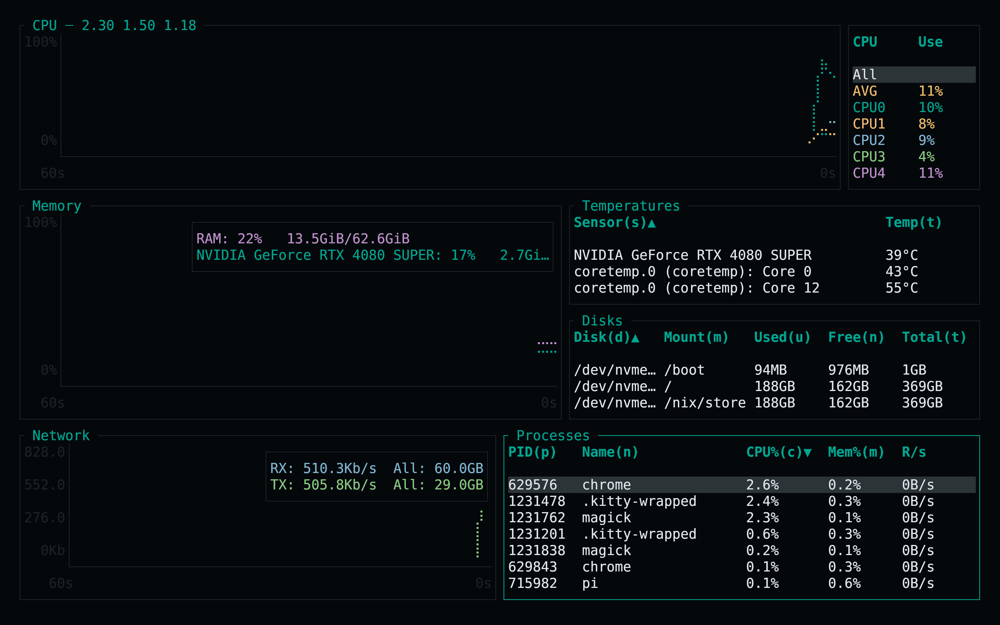
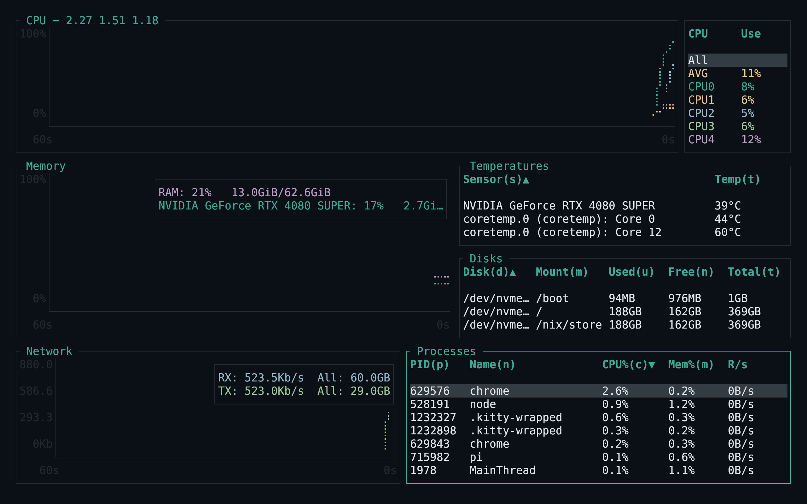
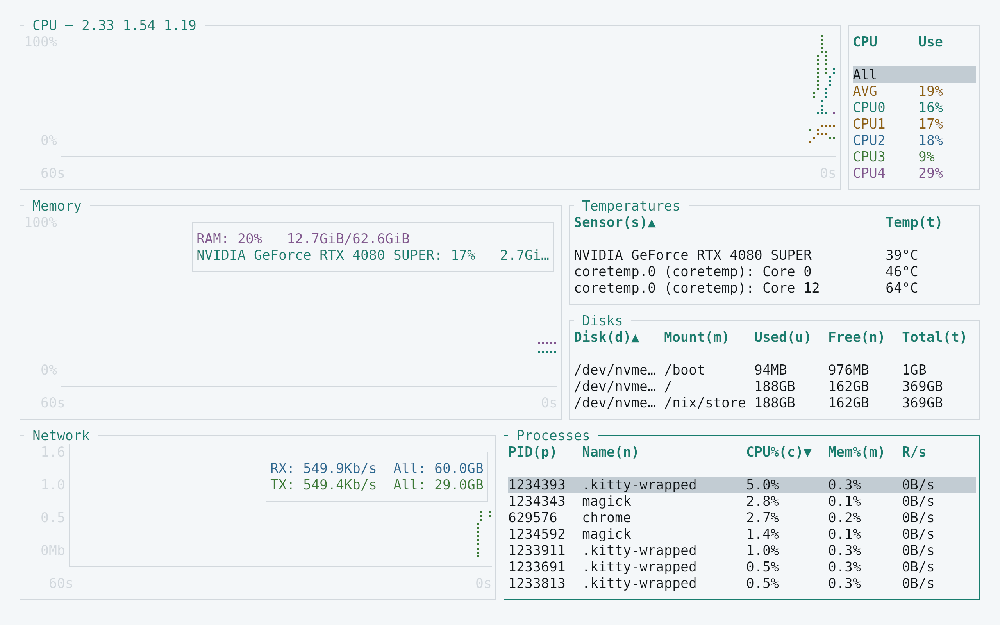
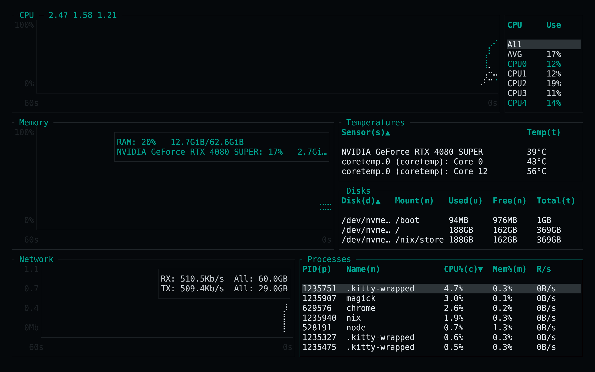

<!-- living-code-readme:1 -->
# 📊 Living Code for bottom

**Calm slate. Living color.** Living Code for bottom: native TOML styles for CPU, memory, network, batteries, graphs, tables and selected widgets.

[Installation](#installation) · [Flavors](#flavors) · [Configuration](#configuration) · [All ports](https://github.com/living-code-theme)

## Previews

<table data-lc-flavors>
<tr>
<td width="50%" valign="top">
<strong>Night</strong><br><sub>Dark · full palette</sub><br><br>
<a href="images/night.png"></a>
</td>
<td width="50%" valign="top">
<strong>Frost</strong><br><sub>Dark · softer chroma</sub><br><br>
<a href="images/frost.png"></a>
</td>
</tr>
<tr>
<td width="50%" valign="top">
<strong>Paper</strong><br><sub>Light · near-white slate</sub><br><br>
<a href="images/paper.png"></a>
</td>
<td width="50%" valign="top">
<strong>Signal</strong><br><sub>Dark · teal accent</sub><br><br>
<a href="images/signal.png"></a>
</td>
</tr>
</table>

Select any preview to view the image at full size.

## Installation

```sh
flavor=night # night, frost, paper, or signal
curl -fsSL --create-dirs -o "${XDG_CONFIG_HOME:-$HOME/.config}/bottom/themes/living-code-$flavor.toml" "https://raw.githubusercontent.com/living-code-theme/bottom/main/themes/living-code-$flavor.toml"
btm --config "${XDG_CONFIG_HOME:-$HOME/.config}/bottom/themes/living-code-$flavor.toml"
```

This leaves your normal `bottom.toml` untouched. To retain its monitor layout and process settings, merge the downloaded file’s `[styles]` tables into that config instead. Remove duplicate style tables and do not pass a built-in `--color` override.

## Flavors

Expand a flavor for its full-size preview and activation instructions.

<details data-lc-flavor="night">
<summary><strong>Night</strong> · Dark · full palette</summary>

<p><a href="images/night.png"></a></p>

```sh
btm --config "${XDG_CONFIG_HOME:-$HOME/.config}/bottom/themes/living-code-night.toml"
```

</details>

<details data-lc-flavor="frost">
<summary><strong>Frost</strong> · Dark · softer chroma</summary>

<p><a href="images/frost.png"></a></p>

```sh
btm --config "${XDG_CONFIG_HOME:-$HOME/.config}/bottom/themes/living-code-frost.toml"
```

</details>

<details data-lc-flavor="paper">
<summary><strong>Paper</strong> · Light · near-white slate</summary>

<p><a href="images/paper.png"></a></p>

```sh
btm --config "${XDG_CONFIG_HOME:-$HOME/.config}/bottom/themes/living-code-paper.toml"
```

</details>

<details data-lc-flavor="signal">
<summary><strong>Signal</strong> · Dark · teal accent</summary>

<p><a href="images/signal.png"></a></p>

```sh
btm --config "${XDG_CONFIG_HOME:-$HOME/.config}/bottom/themes/living-code-signal.toml"
```

</details>

## Configuration

The file contains only `[styles]` and its child tables. Remove existing duplicates before merging. Do not pass `--color` when testing the custom palette: a built-in-theme command-line override takes precedence. CPU, temperature and GPU series use a consistent set of Living Code semantic hues. Widget text and selected text use explicit foreground/background pairs.

## Compatibility

Targets bottom’s current `[styles]` format, verified against its complete upstream valid-style fixture. Older releases using different styling keys are not claimed. Truecolor is recommended. Tests parse TOML, check section/field names against the fixture and verify foreground/selection contrast; the native application is also captured automatically.

Previews are captured programmatically from the actual application in an isolated profile. See [`capture/app.py`](capture/app.py) for the app-owned recipe and [`images/capture.json`](images/capture.json) for runtime, palette and image provenance. No mock interface is drawn.

## Contributing

Found a problem? [Open an issue](https://github.com/living-code-theme/bottom/issues/new/choose) with the app version, the flavor and a screenshot. Want Living Code somewhere else? [Request a port](https://github.com/living-code-theme/core/issues/new?template=port-request.yml).

Pull requests are welcome. Keep this README, `port.json` and `images/` in sync, and use real screenshots of the app, never mockups.

🦎 **One chameleon, many habitats.** Part of [Living Code](https://github.com/living-code-theme).

## License

[MIT](LICENSE) © Elliot Luque
